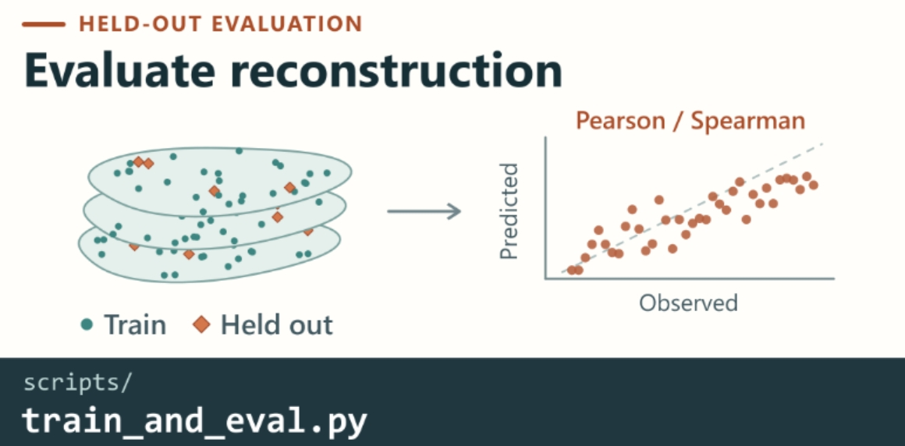
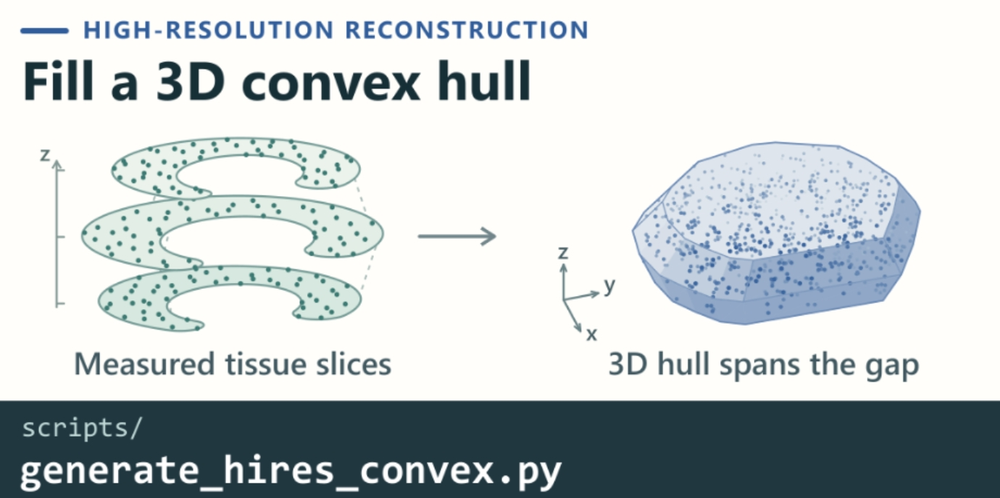
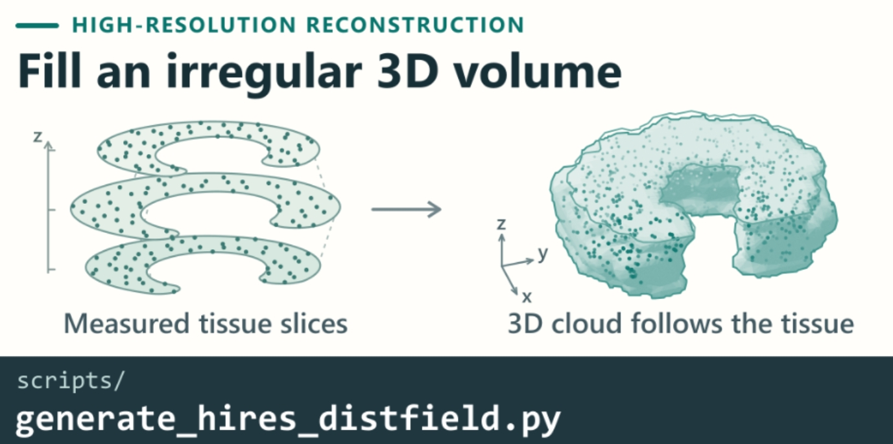
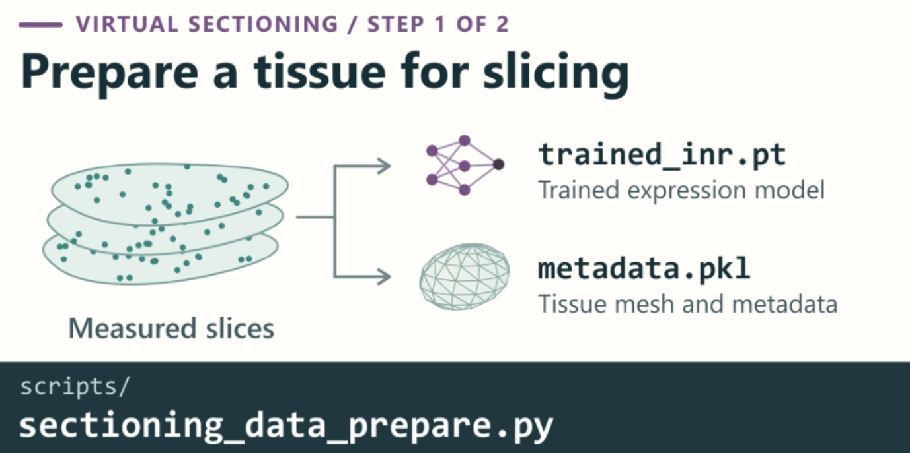
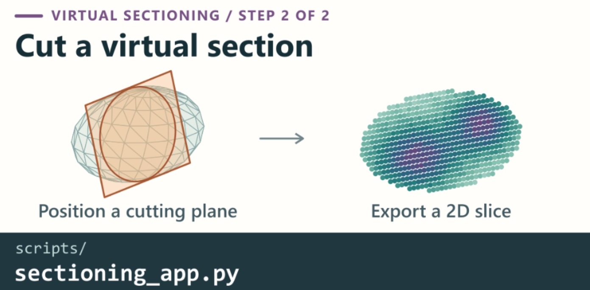
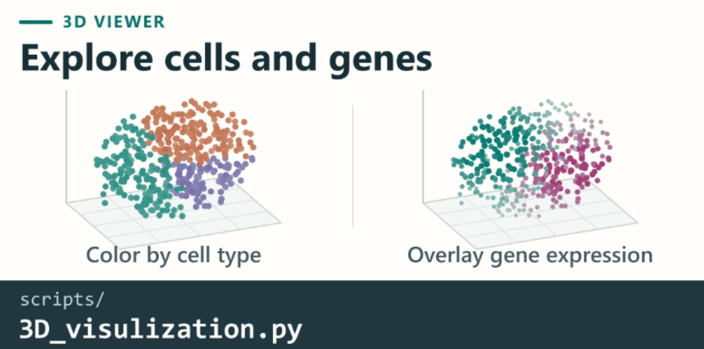

# Neural Transcriptomic Field (NTF)

NTF is a deep learning framework for reconstructing continuous 3D gene expression fields from sparse spatial transcriptomics data. It uses a hash-grid-based implicit neural representation (INR) to model gene expression as a continuous function of 3D coordinates, enabling high-resolution reconstruction across multiple tissue sections.

## Start Here

### End-to-end tutorials

The [`tutorial/`](tutorial/) directory contains two executed Jupyter notebooks with saved metrics and figures. Each notebook includes its input-data download link and runs the complete workflow rather than relying on precomputed model outputs.

| Notebook | What it demonstrates |
|---|---|
| [1. Sparse 2D sections to a high-resolution 3D field](tutorial/01_simulation_reconstruction.ipynb) | Build sparse, mixed-resolution input from the mouse-brain simulation, train NTF, reconstruct all 1,975,530 original coordinates, and evaluate the 100-gene reconstruction with 2D and 3D visualizations. |
| [2. weMERFISH scenarios, quantitative metrics and niche heterogeneity](tutorial/02_wemerfish_scenarios.ipynb) | Train and evaluate five models on real zebrafish-embryo data, covering interleaved-section interpolation, a contiguous middle gap, boundary extrapolation, expression metrics, cell typing, and niche composition. |

The full 20,000-iteration training workflows are configured for a CUDA-capable GPU (`cuda:0` by default). Open the notebooks on GitHub to inspect their executed outputs before deciding whether to rerun them.

### Visual guide to command-line scripts

If you already have an `.h5ad` file, use the diagrams below to choose the right tool. Click any diagram for detailed arguments, examples, and outputs.

| Script workflow | Script workflow |
|---|---|
| [](scripts/README.md#train_and_evalpy) | [](scripts/README.md#generate_hires_convexpy) |
| **Held-out evaluation**: [`train_and_eval.py`](scripts/train_and_eval.py) | **Convex tissue shapes**: [`generate_hires_convex.py`](scripts/generate_hires_convex.py) |
| [](scripts/README.md#generate_hires_distfieldpy) | [](scripts/README.md#sectioning_data_preparepy) |
| **Non-convex or complex shapes**: [`generate_hires_distfield.py`](scripts/generate_hires_distfield.py) | **Virtual sectioning, step 1**: [`sectioning_data_prepare.py`](scripts/sectioning_data_prepare.py) |
| [](scripts/README.md#sectioning_apppy) | [](scripts/README.md#3d_visulizationpy) |
| **Virtual sectioning, step 2**: [`sectioning_app.py`](scripts/sectioning_app.py) | **Interactive 3D exploration**: [`3D_visulization.py`](scripts/3D_visulization.py) |

## Model Architecture


The NTF model consists of the following key components:

- **Hash Grid Encoding**: Multi-resolution hash grid that encodes 3D spatial coordinates into compact feature vectors.
- **Expression Network (GeneINR)**: An MLP that maps encoded features to gene expression values using a softplus activation.
- **Dropout Network**: An auxiliary MLP that predicts dropout probabilities to handle zero-inflation in spatial transcriptomics data.
- **Slice Embedding**: Learnable embeddings for each tissue section to capture section-specific effects.
- **Variance Network**: Predicts per-pixel uncertainty (variance) for probabilistic modeling.
- **Bias Network** (optional): Predicts section-level bias corrections.

## Installation

Install [tiny-cuda-nn](https://github.com/NVlabs/tiny-cuda-nn):

```bash
pip install git+https://github.com/NVlabs/tiny-cuda-nn/#subdirectory=bindings/torch
```

Then install NTF:

```bash
pip install -e .
```

## Requirements

See `requirements.txt` for the full list of dependencies. Key dependencies:

- `torch`
- `anndata`
- `scipy`
- `tqdm`
- `tensorboard`

## Usage

### Python API

```python
import anndata
import numpy as np
import torch
from NTF import train, sample_points
from NTF.config import add_shared_args, process_args

# Load your spatial transcriptomics data (AnnData format)
adata = anndata.read_h5ad("your_data.h5ad")
adata.obsm['spatial'] = adata.obsm['spatial'].astype(np.float32)

# Parse and process arguments
parser = add_shared_args()
args = parser.parse_args([
    "--input_data", "your_data.h5ad",
    "--output_dir", "./output",
    "--slice_id", "slice_id",   # obs column with section labels
])
args = process_args(args)

# Compute spatial scaling factor (normalises coordinates to [0, 1] range)
raw_bbox_size = (adata.obsm['spatial'].max(0) - adata.obsm['spatial'].min(0)).max()
spatial_scaling = 1.0 / raw_bbox_size if raw_bbox_size > 0 else 1.0
adata.obsm['spatial'] *= spatial_scaling

# Train the model
model = train(adata, args)

# Sample gene expression at new 3D coordinates (apply the same scaling)
xyz_raw = np.array([[x, y, z], ...], dtype=np.float32)
xyz_scaled = torch.from_numpy(xyz_raw * spatial_scaling).to(args.device)
output = sample_points(model.inr, xyz_scaled)
expression = output["expression"]  # shape: [N, n_genes]
```

### Optional cell-type annotation (`--cat_keys`)

If `--cat_keys` is provided during training (e.g. `--cat_keys cell_type leiden`), NTF builds a label annotator on the training coordinates. The annotator is attached to the trained model (`model.inr.annotator`), saved to `output_dir/label_annotator.pkl`, and `sample_points()` then returns an additional `output["labels"]` dict mapping each categorical key to the predicted labels for the query coordinates:

```python
args = parser.parse_args([..., "--cat_keys", "cell_type"])
model = train(adata, args)
output = sample_points(model.inr, xyz_scaled)
labels = output["labels"]["cell_type"]  # predicted label per query point
```

### Frequently Used Command-line Arguments

| Argument                  | Default  | Description                                                                     |
| ------------------------- | -------- | ------------------------------------------------------------------------------- |
| `--input_data` / `-i` | required | Path to `.h5ad` input file                                                    |
| `--output_dir` / `-o` | required | Directory to save results                                                       |
| `--slice_id`            | required | `adata.obs` column for slice IDs                                              |
| `--n_iter`              | 20000    | Total training iterations                                                       |
| `--batch_size`          | 8192     | Batch size                                                                      |
| `--learning_rate`       | 1e-4     | Learning rate                                                                   |
| `--width`               | 64       | MLP layer width                                                                 |
| `--depth`               | 1        | MLP depth                                                                       |
| `--no_dropout`          |          | Disable dropout prediction network (Only used with dense data)                  |
| `--cat_keys`            | `[]`   | Categorical `adata.obs` columns (e.g. cell types) to annotate at query points |

## Input Data Format

The model expects an `AnnData` object with:

- `adata.X`: Gene expression matrix (cells × genes), can be sparse
- `adata.obsm['spatial']`: 3D spatial coordinates (cells × 3)
- `adata.obs[slice_id]`: Section/slice identifier column

## Scripts

The `scripts/` directory provides ready-to-use command-line tools built on top of the NTF library:

| Script                          | Description                                                                                                                                                               |
| ------------------------------- | ------------------------------------------------------------------------------------------------------------------------------------------------------------------------- |
| `train_and_eval.py`           | Train an NTF model and evaluate reconstruction quality on a held-out test set. Supports both random and label-based train/test splitting.                                 |
| `generate_hires_convex.py`    | Train a model and generate a high-resolution point cloud by sampling new coordinates inside the convex hull of the original tissue.                                       |
| `generate_hires_distfield.py` | Train a model and generate a high-resolution point cloud by sampling within a KD-Tree distance-field boundary, suitable for non-convex tissue shapes.                     |
| `sectioning_data_prepare.py`  | Train a model and pre-compute all assets (mesh, metadata) required by the interactive sectioning app.                                                                     |
| `sectioning_app.py`           | Interactive Dash web app for in-silico virtual sectioning: define a cutting plane, run inference, and visualise gene expression or cell-type annotations on the 2D slice. |
| `3D_visulization.py`          | Interactive Dash web app for exploring `.h5ad` data in 3D: visualise categorical variables or multi-gene expression with filtering and adaptive opacity controls.       |

See [`scripts`](scripts/) for detailed usage instructions and argument descriptions.

## Analysis: paper reproduction scripts

The [`analysis/`](analysis/) directory contains the final NTF-side scripts used to reproduce the paper's experiments and revision analyses. Unlike the general-purpose tools in `scripts/`, these pipelines are organized by dataset and include experiment-specific preprocessing, evaluation, summarization, and figure generation. Each directory's README documents the required inputs and reproduction commands.

| Directory | Reproduction contents |
|---|---|
| [`simulation/`](analysis/simulation/) | Simulation generation; scale, sparse-section, mixed-resolution, gene-count, SVG-conservation, UniST-comparison, and model-ablation analyses. |
| [`STARmap_mouse_VC/`](analysis/STARmap_mouse_VC/) | Reconstruction and cell-typing evaluation, model-component ablation, in-silico query/occupancy-filter validation, and spatial scale-bar checks. |
| [`deep_starmap_brain/`](analysis/deep_starmap_brain/) | Five-scenario Deep-STARmap benchmark, unified reconstruction/SVG/cell-typing metrics, efficiency summaries, and figures. |
| [`wemerfish_zebrafish_embryo/`](analysis/wemerfish_zebrafish_embryo/) | Data preparation, cell/niche-typing evaluation, composition summaries, figures, and validation of the complete notebook retraining workflow. |
| [`cycif_crc1_3d/`](analysis/cycif_crc1_3d/) | CRC1 preprocessing and annotation, MAPS alignment, five-scenario NTF reconstruction, cell/niche and SVG evaluation, baseline-feasibility analysis, and figures. |
| [`mouse_embryo/`](analysis/mouse_embryo/) | E16.5 cell-type distribution, per-section frequency, 3D morphology comparisons, and summary tables. |

Large datasets and generated benchmark outputs are not committed to this directory; follow the data links and paths in the per-dataset READMEs. For a guided introduction, use the [tutorials](#end-to-end-tutorials) above.
